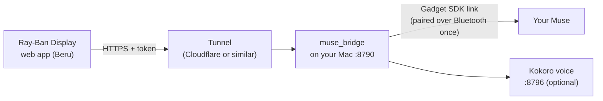

# muse-glasses

**Talk to your own [Muse](https://muse.ai) from Meta Ray-Ban Display glasses.**

A small web app on the glasses (called **Beru** here, after my assistant) chats with your Muse. Your Mac pairs with Muse as a "gadget" using Meta's open-source [Muse Gadget SDK](https://github.com/facebookincubator/muse-gadget-sdk), ported to macOS, and relays messages between the glasses and Muse.

<!-- demo video goes here -->

> **Unofficial personal project.** Not affiliated with, endorsed by, or supported by Meta. Muse, Meta and Ray-Ban Display are trademarks of their owners. The Gadget SDK is "not a supported product" and may change or stop working at any time.

## What it does

- **One pinch, then talk.** The message box is selected when the app opens. Pinch, dictate, and it sends by itself two seconds after you stop.
- **Live progress.** While Muse works you see what it's doing ("Checking your calendar…"), with the Muse mascot reacting: working, answering, celebrating.
- **Spoken answers** in a natural local voice ([Kokoro](https://github.com/thewh1teagle/kokoro-onnx), free, runs on your Mac), sentence by sentence. It falls back to the glasses' built-in voice.
- **Approvals.** When Muse needs you to approve something, the glasses show it and point you to your phone.
- **A normal chat.** Swipe up and down through the conversation. The last three days stay on the glasses.
- **Opens instantly.** After the first launch the app is stored on the glasses and connects in the background.
- **Locked down.** Muse gets no shell or file access on your Mac. The glasses need a secret token, and one command shuts everything off.

## How it works



| Piece | Folder |
|---|---|
| macOS gadget: a CoreBluetooth stand-in for the SDK's Linux (BlueZ) pairing server | `musegadget_mac/` |
| Bridge: keeps the Muse session, serves the web app and a small HTTP API | `muse_bridge/` |
| Glasses web app: React and Meta's Wearables UI Toolkit | `webapp/` |
| Meta's Gadget SDK, cloned at a pinned commit by the installer (not committed) | `vendor/muse-gadget-sdk/` |

## What you need

- Meta Ray-Ban Display glasses, paired to the **Meta AI** app, with **Developer Mode** on. In the Meta AI app: Settings → App Info → tap the version number 5 times.
- A Muse account, and the **Muse app** on your phone with **Developer mode** on under Settings → Devices.
- A **Muse Gadget SDK token**, from [gadgets.muse.ai/settings/sdk-tokens](https://gadgets.muse.ai/settings/sdk-tokens). Read the [token terms](https://gadgets.muse.ai/sdk-terms): the token is personal, so never share it.
- A Mac with Bluetooth that stays on (a Mac mini is ideal), plus [`uv`](https://docs.astral.sh/uv/), Node 20+ and git. The voice also needs `ffmpeg` (`brew install ffmpeg`).
- A way to reach the Mac over HTTPS from the internet. Easiest is a free [Cloudflare Tunnel](https://developers.cloudflare.com/cloudflare-one/connections/connect-networks/) on a domain you own. [Tailscale Funnel](https://tailscale.com/kb/1223/funnel) also works.

Everything here is free to run.

## Setup

### 1. Store your SDK token in the Keychain

```bash
security add-generic-password -a "$USER" -s muse-gadget-sdk-token -w
# paste the token when asked
```

### 2. Install

```bash
git clone https://github.com/sidart10/muse-glasses.git
cd muse-glasses
scripts/install.sh --host glasses.example.com --voice
```

`--host` is the public hostname your tunnel will serve. `--voice` adds the local Kokoro voice, about 350 MB of model files.

The installer:
- clones the Gadget SDK at a pinned commit;
- builds the web app and runs the tests;
- copies the runtime to `~/Library/Application Support/muse-glasses/runtime`, because launchd can't read `~/Desktop` without a privacy prompt;
- starts two background services, the bridge and the voice.

Settings are saved in `~/Library/Application Support/muse-glasses/config.env`.

### 3. Pair the Mac with your Muse

```bash
.venv/bin/python -m musegadget_mac pair
```

Then, in the Muse app: Settings → Devices → **+** → pick the `MuseGadget…` name the command prints. After pairing, restart the bridge with `./deploy.sh`.

### 4. Point a tunnel at the bridge

With Cloudflare:

```bash
cloudflared tunnel login
cloudflared tunnel create muse-glasses
cloudflared tunnel route dns muse-glasses glasses.example.com
```

Then run the tunnel with a config that sends everything to the bridge:

```yaml
# ~/.cloudflared/muse-glasses.yml
tunnel: muse-glasses
credentials-file: /Users/<you>/.cloudflared/<tunnel-id>.json
ingress:
  - hostname: glasses.example.com
    service: http://127.0.0.1:8790
  - service: http_status:404
```

```bash
cloudflared tunnel --config ~/.cloudflared/muse-glasses.yml run
```

To keep it running across reboots, use `sudo cloudflared service install` or a LaunchAgent.

### 5. Install the app on your glasses

```bash
.venv/bin/python -m muse_bridge link --qr ~/Desktop/glasses-install.png
```

Scan the QR code with your phone. It opens the Meta AI app and installs **Beru** on the glasses. Use `--name` to call it something else.

**The QR code contains your glasses token: don't share it.** Delete the image once you've installed the app.

## Using it

| Gesture | What it does |
|---|---|
| Index pinch on the message box | Opens dictation. Speak, and it sends after a two-second pause. |
| Swipe up / down | Moves through the chat. |
| Index pinch on an approval | Shows what Muse wants to do (approve it on your phone). |
| Middle-finger pinch (Back) | Closes the approvals screen. On the chat itself, it opens the glasses' system menu (Meta's design). |

## Security

- **Muse can't run anything on your Mac.** The upstream SDK lets Muse run shell and file commands on a gadget. This port offers Muse no commands at all, and a test enforces that.
- **The glasses need a long random token,** carried in the install QR code and checked on every request. It's stored in the Keychain (`muse-bridge-api-token`) and never written to logs: the access log records paths only.
- **Kill switch:** `.venv/bin/python -m muse_bridge off` refuses every request and rotates the token. `on` turns it back on; then make a new QR code.
- **The SDK token stays in your Keychain** (`muse-gadget-sdk-token`). Don't revoke it before re-pairing with a new one: revoking the token also revokes the device.
- Only messages go between the glasses, the bridge and Muse. Nothing is sent to any other service.

## Known limits

- **"Hey Meta" voice routing doesn't really work.** The web app registers WebMCP tools (`ask_beru`, `read_beru_answer`), but Meta AI only offers them while the app is open in front of you, and in practice rarely calls them. Use dictation in the app.
- **Launcher icons are one color.** The glasses tint a single-color mask, so there's no full-color logo or animation. They also store the icon per app address: to change it, change `APP_PATH` in `muse_bridge/server.py` and reinstall.
- **Main Muse chat only.** Replies in side threads never reach a gadget, so the bridge uses your main chat.
- **Text replies.** The SDK's voice output mode currently fails on Muse's side, so the Mac speaks the text instead.

## Optional: the Muse mascot

The mascot isn't included: the artwork is Meta's. If the Muse app is installed on your Mac, you can extract it for your own use. Without it, the app shows the toolkit's sparkle icon.

```bash
uv venv /tmp/mascot-tools && uv pip install --python /tmp/mascot-tools/bin/python "rembg[cpu]" pillow
/tmp/mascot-tools/bin/python -I tools/make_mascot.py webapp/public/mascot
/tmp/mascot-tools/bin/python -I tools/make_icons.py
/tmp/mascot-tools/bin/python -I tools/make_launcher_glyph.py /Applications/Muse.app/Contents/Resources/Hatch.jpg webapp/public/icons/mascot-launcher.png
./deploy.sh
```

These outputs are gitignored: keep them out of any repository you publish.

## Development

```bash
.venv/bin/python -m pytest -q                       # bridge tests
.venv/bin/python -m muse_bridge serve --fake        # practice mode, no Muse needed: http://127.0.0.1:8790/beru/#k=<token>
cd webapp && npm run dev                            # web app with hot reload
./deploy.sh                                         # build, test, copy to the runtime, restart services
```

- **Logs:** `~/Library/Logs/muse-bridge.log` and `muse-glasses-voice.log`.
- **Start-up diagnostics:** each time the glasses open the app, it logs a `glasses diag:` line with timings.
- **Simulator:** Meta's Ray-Ban Display Simulator Chrome extension is handy for checking layouts at 600×600.

## Troubleshooting

- **The Muse app can't find the Mac when pairing.** macOS has to advertise by name only, which is the default here (`MUSEGADGET_ADV=name`). Keep the Muse app's Devices screen open and close to the Mac.
- **The app says "Mac offline".** Check the bridge log, and that the tunnel is up: `curl https://<host>/beru/` should return the page.
- **The voice is slow.** The voice service must run with `ProcessType=Interactive`, which the installer sets. Otherwise macOS throttles it.
- **A new version doesn't show.** The glasses keep a stored copy and refresh it in the background, so a new deploy appears on the launch after next.

## License

Apache License 2.0. See [LICENSE](LICENSE) and [NOTICE](NOTICE). Builds on Meta's Muse Gadget SDK and Wearables UI Toolkit, both Apache-2.0.
